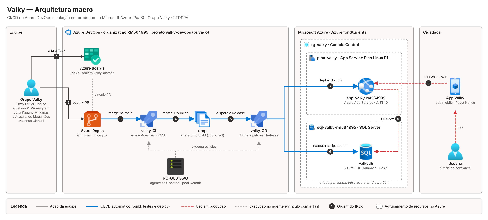

# Valky — API .NET (Global Solution 2026/2 · CitizenTech)

**Grupo Valky** · 2TDSPV

| RM | Nome |
|---|---|
| 563379 | Enzo Xavier Coelho |
| 564995 | Gustavo Ribeiro Permagnani |
| 565568 | Júlia Kauane Menezes Farias |
| 566457 | Larissa Juvenal de Magalhães |
| 565258 | Matheus Gianolli |

## A solução

A Valky é um app de proteção para mulheres em risco de violência doméstica. Disfarçado de calculadora, ele permite disparar um alerta silencioso que envia localização e contexto para a polícia, enquanto a rede de confiança acompanha o andamento do atendimento. Ele protege desde o registro do BO, antes da medida protetiva.

Esta API (.NET 10, Minimal API, EF Core, Azure SQL) recebe os **alertas** e o **histórico de status** do atendimento.

ODS: 11 (cidades e comunidades sustentáveis), 10 (redução das desigualdades), 3 (saúde e bem-estar).

## Arquitetura macro



Fonte editável: [`docs/arquitetura.drawio`](docs/arquitetura.drawio) (abrir em app.diagrams.net).

1. A equipe cria a Task no Azure Boards.
2. Faz push da branch `feature/task-N` no Azure Repos e abre o Pull Request vinculado à Task (`#N`).
3. O merge na `main` dispara a pipeline de CI `valky-CI`.
4. A CI compila, executa os testes xUnit e publica o artefato.
5. O artefato `drop` (`Valky.Api.zip` + `script-bd.sql`) dispara a Release `valky-CD`.
6. A Release executa o `script-bd.sql` no Azure SQL Database `valkydb`.
7. A Release publica o `Valky.Api.zip` no Azure App Service `app-valky-rm564995`.
8. O app mobile consome a API por HTTPS, autenticado com JWT.
9. A API lê e grava os dados no Azure SQL Database via EF Core.

## Links

| | |
|---|---|
| API em produção | https://app-valky-rm564995.azurewebsites.net |
| Swagger | https://app-valky-rm564995.azurewebsites.net/swagger |
| Health check | https://app-valky-rm564995.azurewebsites.net/health |
| Azure DevOps (projeto) | https://dev.azure.com/RM564995/valky-devops |
| Vídeo de demonstração | _link do YouTube_ |

## CI/CD (Azure DevOps)

- **Azure Boards:** cada mudança nasce de uma Task; commits usam `#N` para vincular.
- **Azure Repos:** branch `main` protegida (mínimo 1 revisor, work item obrigatório, revisor padrão). Branches no padrão `feature/task-N`.
- **CI (`azure-pipeline.yml`):** dispara a cada commit na `main`. Etapas: instalar .NET 10, restore, build, testes xUnit (com publicação dos resultados e da cobertura), publish da API em `.zip`, cópia do `script-bd.sql` e publicação do artefato `drop`.
- **Release (`valky-CD`):** gatilho de deploy contínuo no artefato da `main`. Etapas: executar `script-bd.sql` no Azure SQL e fazer o deploy no App Service. Usa variáveis de pipeline; a senha do banco é uma variável secreta.
- **Versões:** SDK do .NET `10.0.103` (`global.json`); pacotes NuGet com versões exatas e `packages.lock.json`.
- **Agente:** self-hosted `PC-GUSTAVO` (pool Default).
- **Service connection:** `sc-azure-valky` (Azure Resource Manager, escopo do Resource Group `rg-valky`).
- **GitHub:** cópia da `main` para a entrega da disciplina de .NET.

## Estrutura do repositório

```
├── azure-pipeline.yml        # Pipeline de Build (CI)
├── global.json               # Versão fixa do SDK .NET
├── docs/
│   ├── arquitetura-valky.drawio.png  # Desenho da arquitetura macro
│   └── arquitetura.drawio    # Fonte editável (Draw.io)
├── scripts/
│   ├── infra-azure.sh        # Provisionamento via Azure CLI
│   └── script-bd.sql         # DDL das tabelas (Azure SQL)
├── src/Valky.Api/            # Minimal API (+ packages.lock.json)
└── tests/Valky.Tests/        # Testes unitários e de integração xUnit (+ packages.lock.json)
```

## Infraestrutura (Azure CLI)

No Azure Cloud Shell (Bash):

```bash
git clone https://dev.azure.com/RM564995/valky-devops/_git/valky-devops
cd valky-devops
az account set --subscription <id-da-assinatura>
chmod +x scripts/infra-azure.sh
./scripts/infra-azure.sh
```

Recursos criados (região `canadacentral`):

| Recurso | Nome |
|---|---|
| Resource Group | `rg-valky` |
| Azure SQL Server | `sql-valky-rm564995` |
| Azure SQL Database (Basic) | `valkydb` |
| App Service Plan (Linux, F1) | `plan-valky` |
| Web App (.NET 10) | `app-valky-rm564995` |

A senha do banco é informada na execução do script e fica na connection string `DefaultConnection` do Web App e na variável secreta da Release.

## Tabelas

- `dbo.Alertas` — alerta disparado pela usuária (BO, localização, status).
- `dbo.AtualizacoesStatus` — andamento do atendimento (FK para `Alertas`).

Status válidos: `ABERTO`, `VIATURA_A_CAMINHO`, `NO_LOCAL`, `ENCERRADO`.

## Endpoints e JSON do CRUD

### Alertas — `/api/alertas`

| Operação | Método | Rota |
|---|---|---|
| Create | POST | `/api/alertas` |
| Read | GET | `/api/alertas` e `/api/alertas/{id}` |
| Update | PUT | `/api/alertas/{id}` |
| Delete | DELETE | `/api/alertas/{id}` |

POST:
```json
{
  "codigoBo": "BO-2026-000123",
  "latitude": -23.550520,
  "longitude": -46.633308
}
```

PUT:
```json
{
  "codigoBo": "BO-2026-000123",
  "latitude": -23.551000,
  "longitude": -46.634000,
  "status": "VIATURA_A_CAMINHO"
}
```

### Atualizações de status — `/api/atualizacoes-status`

| Operação | Método | Rota |
|---|---|---|
| Create | POST | `/api/atualizacoes-status` |
| Read | GET | `/api/atualizacoes-status`, `/api/atualizacoes-status?alertaId={id}` e `/api/atualizacoes-status/{id}` |
| Update | PUT | `/api/atualizacoes-status/{id}` |
| Delete | DELETE | `/api/atualizacoes-status/{id}` |

POST:
```json
{
  "alertaId": 1,
  "status": "VIATURA_A_CAMINHO",
  "observacao": "Viatura despachada",
  "responsavel": "Central 190"
}
```

PUT:
```json
{
  "alertaId": 1,
  "status": "NO_LOCAL",
  "observacao": "Viatura chegou ao local",
  "responsavel": "Central 190"
}
```

Consultas no banco (Query Editor do Azure SQL):
```sql
SELECT * FROM dbo.Alertas ORDER BY Id DESC;
SELECT * FROM dbo.AtualizacoesStatus ORDER BY Id DESC;
```

## Rodar localmente

```bash
dotnet user-secrets init --project src/Valky.Api
dotnet user-secrets set "ConnectionStrings:DefaultConnection" "<sua-connection-string>" --project src/Valky.Api
dotnet run --project src/Valky.Api
dotnet test tests/Valky.Tests
```

Os testes de integração usam a `WebApplicationFactory` com o provedor EF Core InMemory.

## Declaração de uso de IA generativa

Ferramenta: Claude (Anthropic). Usada como apoio para estruturar o esqueleto da API, os scripts de Azure CLI e a pipeline YAML. Todo o conteúdo foi revisado, executado e entendido pelo grupo.
